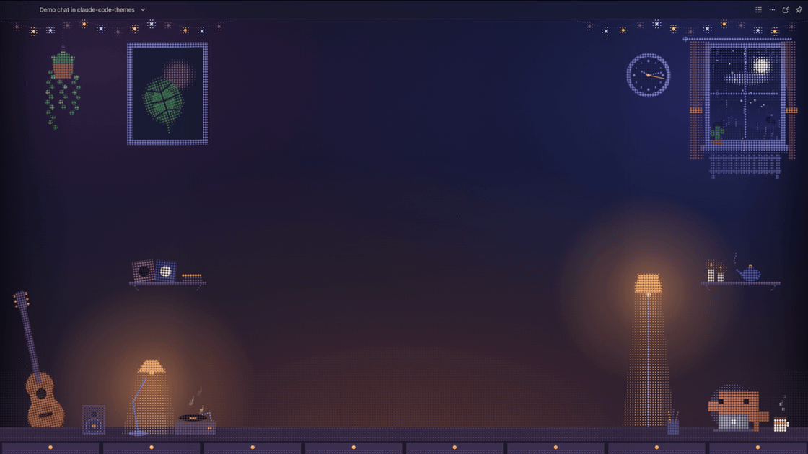
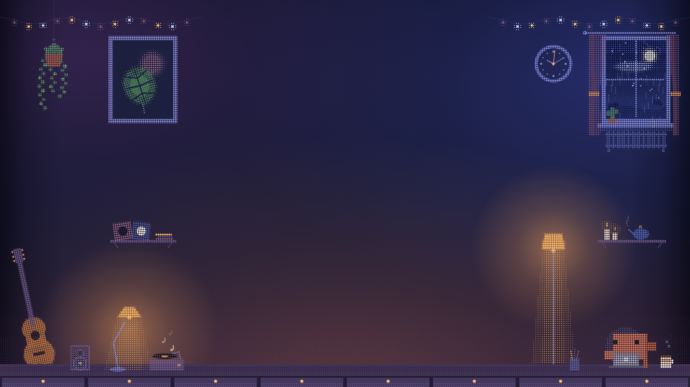
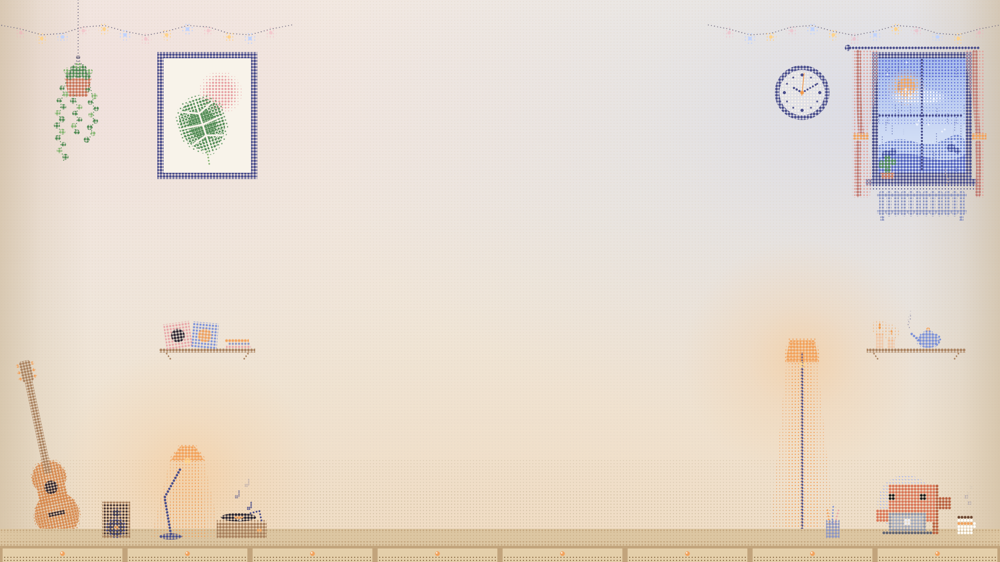

# claude-code-themes

Animated themes for the Code tab of the Claude desktop app. Each theme recolors the app and paints a living scene behind your conversation, drawn in the same style as the app. Under the hood, each one is a Claude Code [mod](https://code.claude.com/docs/en/plugins/mods/overview) packaged as a plugin.

## Themes

| Theme | Preview | What it is |
| --- | --- | --- |
| [rainy-window](themes/rainy-window) |   | Clawd's room on a rainy day, in halftone dots: rain on the window, a record spinning, lamps glowing, and Clawd typing at his desk. Light mode is a rainy afternoon, dark mode a lamp-lit night. |

## Setup

You need the Claude desktop app, updated to the latest version, with Claude Code 2.1.325 or later in its Code tab. To check, run `/status` in a Code tab session and read the **Claude Code** row.

In a Code tab session, add this repository as a plugin marketplace and install a theme:

```
/plugin marketplace add ishuagrawal/claude-code-themes
/plugin install rainy-window@claude-code-themes
```

Then start a new session. The theme appears once that session has sent its first message.

## Use

Each theme adds one command:

| Command | What it does |
| --- | --- |
| `/rainy-window off` | Turns the theme off and gives the app its own look back. It stays off in later sessions. |
| `/rainy-window on` | Turns it back on |

A session shows one theme at a time, so keep one theme on at a time.

The scene follows the app's light or dark appearance. It holds still if your system asks for reduced motion, or if the app is drawing without GPU acceleration.

To remove a theme, run `/plugin`, open the **Installed** tab and uninstall it.

## Develop a theme

Each theme is a folder under [`themes/`](themes), listed in [`.claude-plugin/marketplace.json`](.claude-plugin/marketplace.json). To work on one, link it into your skills directory, where Claude Code loads it in every new session with no install step:

```bash
ln -s "$PWD/themes/rainy-window" ~/.claude/skills/rainy-window
```

Uninstall the marketplace copy first, since two plugins with the same name can't both load. Then check it from the repository root:

```bash
claude plugin validate themes/rainy-window
```

To add a theme, give it a folder under `themes/`, add it to `marketplace.json`, and add a row to the table above. [rainy-window's README](themes/rainy-window/README.md#how-it-works) explains what the desktop app requires before it will animate a backdrop.

Built and tested with Claude Code 2.1.325. Mods are an early-access API and may change between releases.

## License

[MIT](LICENSE)
