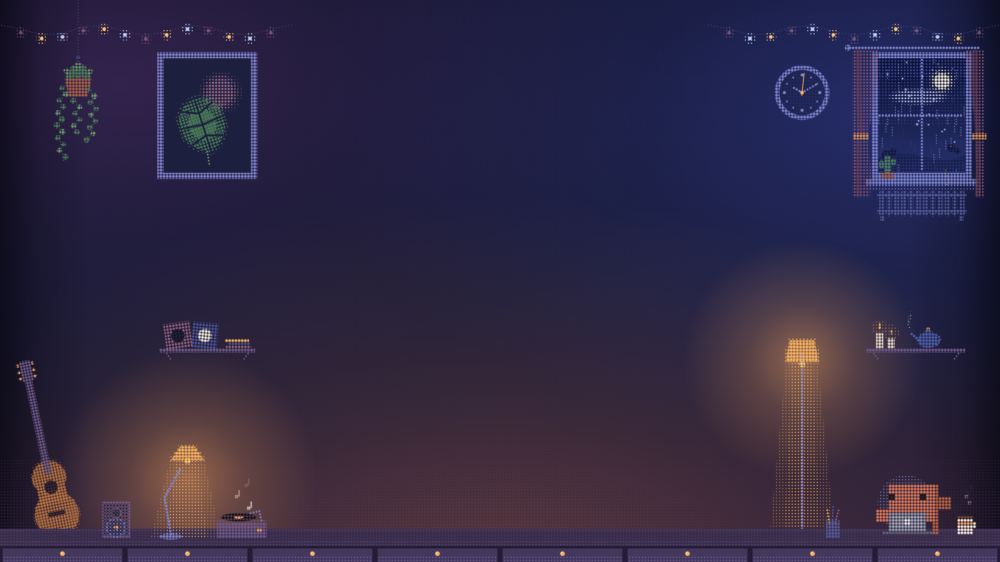
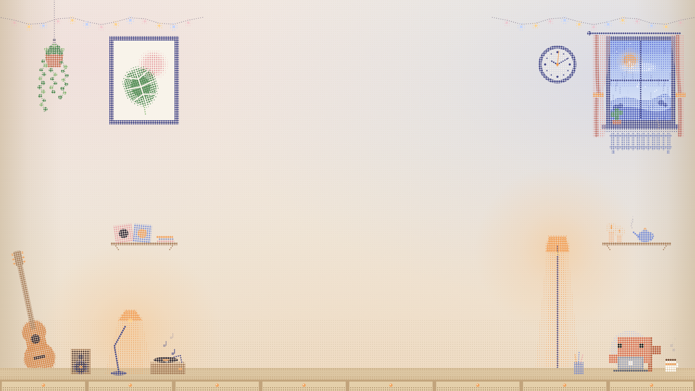

# rainy-window

A theme for the Code tab of the Claude desktop app (and the mobile app): Clawd's room on a rainy day. Rain streaks down the window, a record spins, the lamps are on, and Clawd sits at his desk beside your prompt box, turned a little toward you and typing on his laptop.

It's printed in halftone: every object is round dots on one 6px grid, big dots where a shape is solid and smaller ones toward its edges, over flat washes of color. Light mode is a rainy afternoon and dark mode a lamp-lit rainy night.

The conversation covers the middle, so the room is two mirrored margins with the desk running under them. Each margin has an outer group by the window's edge and an inner group by the conversation, so it looks full whether the sidebar is open or closed and as the window widens:

- **Right, outer**: the window, with hills and trees, a halftone sun by day or a moon, stars and the odd shooting star by night, two layers of rain, drops sliding down the glass, curtains and a cactus on the sill. Under it a radiator with warm air rising, a shelf with two candles and a steaming teapot, and **Clawd** at the desk with his mug.
- **Right, inner**: a wall clock with moving hands over a standing lamp, and a pencil cup on the desk.
- **Left, inner**: a leaf print the same size as the window, a shelf of record sleeves, and a desk lamp beside a record player sending dotted notes up.
- **Left, outer**: a pothos hanging from the ceiling, a guitar leaning on the wall, and a speaker whose cone pulses with the music. When the sidebar is open, these sit under it and show through its glass.
- **Top and bottom**: string lights from both sides, and the desk the prompt box rests on, with a row of plain drawers under it, each with a brass knob.
- **The wall**: soft shadow gathers at each side, where the wall turns the corner, so it sits back between them.

Clawd is the only mascot, the plain one as [clawdhouse](https://github.com/ishuagrawal/clawdhouse) draws him, each of his pixels one dot. He types, blinks, and now and then glances up at you.

Everything is anchored to the window's edges, so the room fits any window size, and the shelves sit a little below the middle of the window. There are no words in the scene.

## Commands

| Command | What it does |
| --- | --- |
| `/rainy-window off` | Take the theme off and give the app its own look back (stays off in later sessions) |
| `/rainy-window on` | Put it back |

A session has one theme at a time, so run one theme mod at a time. Installing and setup are in the [repository README](../../README.md#setup).

## How it works

It follows the docs' recipe for [a backdrop behind the conversation](https://code.claude.com/docs/en/plugins/mods/interface#put-a-backdrop-behind-the-conversation). At session start it makes one `$.theme.set` call with both the app's colors (built with `makeColors`) and a backdrop scene, and a `ui.render` hook draws that scene at the `Backdrop` site.

- `hooks/register.ts` sets the theme, adds the command, and draws the backdrop. The scene doesn't follow the session, so it's drawn once and never redrawn.
- The desktop app moves a backdrop only if the drawing passes its check, and otherwise shows a still copy with the motion stripped out. The check allows a short list of SVG elements and CSS functions, no viewport units, and no media queries except reduced motion's. It also times every frame and holds a scene still if drawing it averages more than about 5.6 ms. So the scene animates with SMIL (`<animate>`, `<animateTransform>`), anchors itself with nested `<svg>` elements instead of `vw`/`vh`, and draws its dots as small patterns rather than masks (about 2.5 ms a frame). It can't ask `prefers-color-scheme` either, so each color is a relative color from `currentColor`, the app's text color, which the app sets on the drawing: dark ink means a light window, cream a dark one.
- `hooks/scene.ts` builds the room: one SVG in the window's own pixels, anchored to the window's edges. Every dotted shape is filled with a 6px dot pattern at one of five dot sizes, so the dots line up across the scene, and Clawd's sprite is masked by a grid of its own with one dot per pixel at the same pitch.
- `hooks/clawd/` holds a copy of clawdhouse's engine (only its arm and leg tables are newly exported). `sheet.ts` draws Clawd's body and face with it in a loop of typing poses, played as a sprite sheet that SMIL steps through.
